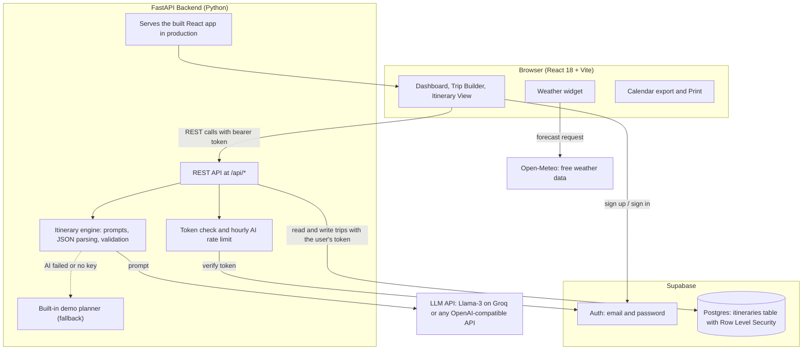

# Wayfinder: Personalized Travel Itinerary Planner ✈️🗺️

> **An AI-powered full-stack web app that turns a destination, dates, budget and interests into an editable day-by-day travel plan.**

[](https://python.org)
[](https://fastapi.tiangolo.com)
[](https://react.dev)
[](https://vitejs.dev)
[](https://supabase.com)
[](https://www.docker.com)
[](https://render.com)

---

## 📌 Project Submission & Mentor Evaluation Overview

| Parameter                 | Details                                                                                                                                               |
| :------------------------ | :---------------------------------------------------------------------------------------------------------------------------------------------------- |
| **Project Title**         | **Personalized Travel Itinerary Planner (Wayfinder)**                                                                                                 |
| **Category / Domain**     | Transportation / Travel (Individual Project)                                                                                                          |
| **GitHub Repository**     | https://github.com/Tanisha18451/travel-itinerary-planner                                                                                              |
| **Live Website**          | https://wayfinder-trip-planner.onrender.com                                                                                                           |
| **Demo Video**            | https://drive.google.com/file/d/1Vs6GqRqaMALDBGzMwBQlzrJ-nTbwWxKQ/view?usp=drive_link                                                                 |
| **Total Epics / Tasks**   | 10 Epics, 24 Tasks (as listed on the project platform)                                                                                                |
| **Skills & Technologies** | **Python**, **FastAPI**, **Generative AI (prompt engineering, Llama-3)**, **React**, **Vite**, **Supabase (Auth + Postgres)**, **Docker**, **Render** |
| **Deployment Mode**       | Single web service: FastAPI serves both the API and the built React app from one link                                                                 |

---

## 📑 Table of Contents

- [Project Context & Problem Statement](#-project-context--problem-statement)
- [Evaluation Scenarios](#-evaluation-scenarios)
- [Key Features](#-key-features)
- [System Architecture](#-system-architecture)
- [Tech Stack](#-tech-stack)
- [How the AI Itinerary Works](#-how-the-ai-itinerary-works)
- [System Requirements](#-system-requirements)
- [Running Modes](#-running-modes)
- [Repository Structure](#-repository-structure)
- [Step-by-Step Local Setup](#-step-by-step-local-setup)
- [Configuration](#-configuration)
- [Database](#-database-supabase)
- [API Reference](#-api-reference)
- [Testing](#-testing)
- [Deploy to Render](#-deploy-to-render)
- [How to Use the App](#-how-to-use-the-app)
- [Epics Mapping](#-epics-mapping)
- [Security & Privacy](#-security--privacy)
- [Limitations & Responsible Use](#-limitations--responsible-use)
- [Troubleshooting](#-troubleshooting)
- [Future Improvements](#-future-improvements)
- [License](#-license)

---

## 📖 Project Context & Problem Statement

Planning a trip means searching many websites for attractions, restaurants, hotels and routes, then fitting everything into a budget and a schedule. It takes hours, it causes decision fatigue, and the result is usually a messy set of notes.

**Wayfinder** removes that work. The traveller enters a destination, dates, total budget, group size, travel style and interests. The app builds a prompt from those inputs, sends it to a generative AI model, then validates the answer and shows a clean, structured plan with attractions, dining, accommodation and transport, each with a time and a cost.

From there the traveller stays in control: they can edit any stop, regenerate a single day, check the weather, tick off a packing list, export to a calendar, print a PDF, or share a read-only link.

---

## 🎯 Evaluation Scenarios

### 🧳 Scenario 1: Solo Traveler Planning a Weekend Getaway

A solo traveler has little time to research. They enter a destination, budget, dates and interests such as food and sightseeing. Within seconds the app returns a balanced itinerary that groups nearby places, suggests affordable dining, and shows the cost of every stop. The traveler follows one clear plan instead of searching across many sites.

### 💑 Scenario 2: Couple Planning a Personalized Vacation

A couple wants a tailored trip, not generic tourist advice. They pick a relaxed pace, scenic interests and a premium comfort level. The app builds a day-wise plan with curated food and experiences. They edit activities, regenerate specific days, watch the budget bar, and adjust the plan together.

### 👥 Scenario 3: Small Group Coordinating a Multi-Day Trip

Friends organising a multi-day holiday enter the group size and a shared budget, and combine interests like adventure and culture. The app structures the days, spreads the cost, and shows the cost per person per day. One person shares the read-only link so everyone sees the same plan, and the calendar export puts it on every phone.

---

## ✨ Key Features

| Area                       | What it does                                                                                                                                 |
| :------------------------- | :------------------------------------------------------------------------------------------------------------------------------------------- |
| 🔐 **Accounts**            | Sign up and sign in with email and password (Supabase Auth). Every user sees only their own trips.                                           |
| 🧭 **Smart trip builder**  | Destination, dates (up to 14 days), total budget, currency, group size, comfort level, pace, interests and notes, with a live summary panel. |
| 🤖 **AI itinerary**        | Day-by-day plan with timed stops for attractions, dining, accommodation and transport, each with a cost.                                     |
| 🛟 **Automatic fallback**  | If the AI is unavailable, a built-in planner still produces a full itinerary, labelled "Demo plan".                                          |
| ✏️ **Full editing**        | Change time, title, description, type and cost of any stop. Add or remove stops. Totals update instantly.                                    |
| 🔄 **Regenerate**          | Regenerate one day (with an optional instruction) or the whole trip.                                                                         |
| 💰 **Budget tracking**     | Spend by category (stays, food, activities, transport), per-person per-day cost, and an over-budget warning.                                 |
| 🌦️ **Weather**             | Forecast for the destination from Open-Meteo (no API key needed).                                                                            |
| 🎒 **Packing list**        | AI-generated checklist for the trip, with progress, custom items and removal.                                                                |
| 📅 **Calendar export**     | Download an `.ics` file for Google or Apple Calendar.                                                                                        |
| 🔗 **Share link**          | Create or revoke a read-only public link to a trip.                                                                                          |
| 🖨️ **Print / PDF**         | Clean all-days printout through the browser print dialog.                                                                                    |
| 📍 **Map links**           | Open any stop in Google Maps.                                                                                                                |
| 📊 **Analytics dashboard** | Next-trip countdown, spend vs budget, spending by category, trips by month, top interests, recent activity, plus search, filter and sort.    |
| 📑 **Duplicate trips**     | Copy a plan to reuse it for a different date or group.                                                                                       |
| 🌙 **Dark mode**           | Light and dark themes.                                                                                                                       |
| 🛡️ **Rate limiting**       | Hourly cap on AI requests per user to protect the API key.                                                                                   |

---

## 🏛️ System Architecture



**Request flow for "Generate itinerary":**

1. The browser sends the trip preferences to `POST /api/itineraries/generate` with the user's Supabase token.
2. The backend verifies the token, checks the hourly limit, and validates the input.
3. The engine builds a prompt, calls the LLM, parses the JSON answer, and normalises it (costs, times, day numbers, totals).
4. If the AI call fails, the built-in planner creates the itinerary instead.
5. The trip is saved in Supabase under the user's account and returned to the browser.

---

## 🧰 Tech Stack

| Layer                   | Technology                                                                             |
| :---------------------- | :------------------------------------------------------------------------------------- |
| **Frontend**            | React 18, Vite 5, plain CSS design system, inline SVG icons and charts (no UI library) |
| **Backend**             | Python, FastAPI, Pydantic v2, Uvicorn, httpx                                           |
| **Database & Auth**     | Supabase (Postgres, Row Level Security, Auth)                                          |
| **Generative AI**       | Any OpenAI-compatible chat API. Default: Llama-3.3-70B on Groq                         |
| **External data**       | Open-Meteo (weather and geocoding, free, no key)                                       |
| **Packaging & Hosting** | Docker (multi-stage build), Render                                                     |

---

## 🧠 How the AI Itinerary Works

- **Prompt engineering.** A system prompt defines a strict JSON schema and rules: total cost within the budget, breakfast, lunch and dinner every day, an overnight stay for each night, nearby places grouped together, and a number of activities that matches the chosen pace. The user prompt adds destination, dates, budget, group, style, pace, interests and notes.
- **Robust parsing.** Model output is cleaned (code fences removed), parsed, and normalised: item types are checked, costs are coerced to numbers, days get correct dates, and totals are recalculated.
- **Automatic fallback.** A network error, rate limit or malformed answer never leaves the user empty-handed. The built-in planner produces a complete itinerary, and the trip card shows a "Demo plan" badge.
- **Targeted regeneration.** Regenerating one day sends the other days' places to the model so it avoids repeats, and keeps the rest of the trip unchanged.
- **Provider-agnostic.** Change `LLM_BASE_URL` and `LLM_MODEL` to use OpenAI, OpenRouter, Together or another OpenAI-compatible provider.

---

## 💻 System Requirements

The AI runs through an API, so no model files or GPU are needed. A normal laptop is enough.

### Hardware

- **Processor:** Any modern dual-core CPU (Intel Core i3 / AMD Ryzen 3 or better)
- **RAM:** 4 GB minimum (8 GB recommended)
- **Storage:** 1 GB free
- **Network:** Internet connection (for the AI API, Supabase, weather and Google Fonts)

### Software

- **OS:** Windows 10 / 11, macOS, or Linux
- **Browser:** Latest Chrome, Edge, Firefox or Safari
- **Python:** 3.10+ (the Docker image uses 3.12)
- **Node.js:** 18+ (the Docker image uses 20)
- **Git:** any recent version
- **Accounts (free):** Supabase, Groq (or another LLM provider), Render, GitHub

---

## 🔀 Running Modes

The app works at three levels. Start with the first and add the others when you are ready.

| Mode                         | AI itineraries   | Login              | Where trips are stored          |
| :--------------------------- | :--------------- | :----------------- | :------------------------------ |
| **Demo** (no keys)           | Built-in planner | None               | `backend/data/itineraries.json` |
| **AI** (add `LLM_API_KEY`)   | Llama-3 via Groq | None               | Local JSON file                 |
| **Full** (add Supabase keys) | Llama-3 via Groq | Email and password | Supabase Postgres               |

> Use **Full** mode for the public website, because Render's free disk is erased on restart.

---

## 📁 Repository Structure

```text
travel-itinerary-planner/
├── backend/
│   ├── app/
│   │   ├── __init__.py
│   │   ├── main.py          # FastAPI routes, share links, static site serving
│   │   ├── ai.py            # Prompts, LLM call, JSON parsing, demo planner
│   │   ├── auth.py          # Supabase token verification
│   │   ├── store.py         # Supabase and local JSON storage
│   │   ├── schemas.py       # Request validation (Pydantic)
│   │   ├── ratelimit.py     # Hourly AI request limit per user
│   │   └── config.py        # Environment settings
│   ├── tests/test_api.py    # Pytest API tests
│   ├── requirements.txt
│   └── .env.example
├── frontend/
│   ├── src/
│   │   ├── App.jsx          # Layout, routing, theme, toasts
│   │   ├── main.jsx         # React entry point
│   │   ├── api.js           # API client
│   │   ├── supabaseClient.js # Supabase connection (empty in demo mode)
│   │   ├── utils.js         # Dates, calendar export, weather labels
│   │   ├── styles.css       # Design system (light and dark)
│   │   └── components/
│   │       ├── Dashboard.jsx      # Analytics dashboard
│   │       ├── Welcome.jsx        # First-time dashboard
│   │       ├── TripBuilder.jsx    # Preference form
│   │       ├── ItineraryView.jsx  # Itinerary, editing, packing, sharing
│   │       ├── SharedTrip.jsx     # Public read-only page
│   │       ├── Weather.jsx        # Forecast widget
│   │       ├── Charts.jsx         # SVG donut and bar charts
│   │       ├── Cover.jsx          # Generated destination artwork
│   │       ├── SideExtras.jsx     # Sidebar content
│   │       ├── AuthPage.jsx       # Sign up and sign in
│   │       └── Icons.jsx          # Icon set
│   ├── index.html
│   ├── package.json
│   ├── package-lock.json
│   ├── vite.config.js       # Vite settings
│   └── .env.example
├── supabase/schema.sql      # Table, security policies and share function
├── Dockerfile               # Multi-stage build: React, then FastAPI
├── render.yaml              # One-click Render blueprint
├── .dockerignore
├── .gitignore
└── README.md
```

---

## 🛠️ Step-by-Step Local Setup

You need **two terminals**: one for the backend, one for the frontend.

### 1. Get the code

```bash
git clone https://github.com/Tanisha18451/travel-itinerary-planner.git
cd travel-itinerary-planner
```

### 2. Start the backend (FastAPI)

```bash
cd backend
python -m venv .venv
```

Activate the virtual environment:

- Windows: `.venv\Scripts\activate`
- macOS / Linux: `source .venv/bin/activate`

```bash
pip install -r requirements.txt
cp .env.example .env          # Windows: copy .env.example .env
uvicorn app.main:app --reload --port 8000
```

- Health check: http://localhost:8000/api/health
- Interactive API docs: http://localhost:8000/docs

### 3. Start the frontend (React + Vite)

```bash
cd frontend
npm install
cp .env.example .env          # Windows: copy .env.example .env
npm run dev
```

Open **http://localhost:5173**. The app already works in demo mode.

### 4. Turn on real AI (recommended)

1. Create a free key at https://console.groq.com.
2. Set `LLM_API_KEY=your_key` in `backend/.env`.
3. Restart the backend. `/api/health` should now show `"ai": "llm"`.

### 5. Turn on Supabase (login and cloud storage)

1. Create a project at https://supabase.com.
2. Open **SQL Editor**, paste all of `supabase/schema.sql`, and click **Run**.
3. Go to **Project Settings, API** and copy the **Project URL** and the **anon public key**.
4. Put them in `backend/.env` (`SUPABASE_URL`, `SUPABASE_ANON_KEY`) and in `frontend/.env` (`VITE_SUPABASE_URL`, `VITE_SUPABASE_ANON_KEY`).
5. For easy testing, go to **Authentication, Providers, Email** and turn off **Confirm email**.
6. Restart both servers. A sign-in page now appears.

---

## ⚙️ Configuration

### Backend (`backend/.env`)

| Variable                 | Default                                       | Description                                    |
| :----------------------- | :-------------------------------------------- | :--------------------------------------------- |
| `CORS_ORIGINS`           | `http://localhost:5173,http://127.0.0.1:5173` | Allowed browser origins                        |
| `SUPABASE_URL`           | empty                                         | Supabase Project URL. Empty means demo storage |
| `SUPABASE_ANON_KEY`      | empty                                         | Supabase anon public key                       |
| `LLM_BASE_URL`           | `https://api.groq.com/openai/v1`              | Any OpenAI-compatible endpoint                 |
| `LLM_MODEL`              | `llama-3.3-70b-versatile`                     | Model name                                     |
| `LLM_API_KEY`            | empty                                         | Provider key. Empty means the built-in planner |
| `LLM_TIMEOUT`            | `60`                                          | Seconds to wait for the model                  |
| `AI_RATE_LIMIT_PER_HOUR` | `30`                                          | AI requests allowed per user per hour          |

### Frontend (`frontend/.env`)

| Variable                 | Default                 | Description                                                                         |
| :----------------------- | :---------------------- | :---------------------------------------------------------------------------------- |
| `VITE_API_URL`           | `http://localhost:8000` | Backend address (not needed in production, where the site and API share one origin) |
| `VITE_SUPABASE_URL`      | empty                   | Same value as `SUPABASE_URL`                                                        |
| `VITE_SUPABASE_ANON_KEY` | empty                   | Same value as `SUPABASE_ANON_KEY`                                                   |

> `.env` files are listed in `.gitignore`. Never commit them.

---

## 🗄️ Database (Supabase)

`supabase/schema.sql` creates:

- **`itineraries` table:** `id`, `user_id`, `title`, `request` (the entered preferences as JSON), `itinerary` (the generated plan as JSON), `source` (`ai` or `demo`), `share_token` (set only while a share link is on), `created_at`, `updated_at`.
- **Row Level Security policies:** a signed-in user can read, insert, update and delete only their own rows.
- **`get_shared_trip` function:** lets the public share page read one trip by its random token, and nothing else. It hides the owner's user id and the token itself.

The packing list and any notes are stored inside the `itinerary` JSON, so they are saved with the trip and kept when you regenerate it.

---

## 🔌 API Reference

All routes except `health` and `shared` need `Authorization: Bearer <Supabase token>` when Supabase is enabled.

| Method   | Endpoint                               | Purpose                                          |
| :------- | :------------------------------------- | :----------------------------------------------- |
| `GET`    | `/api/health`                          | Shows AI, auth and storage mode                  |
| `POST`   | `/api/itineraries/generate`            | Generate and save a new trip                     |
| `GET`    | `/api/itineraries`                     | List your trips                                  |
| `GET`    | `/api/itineraries/{id}`                | Get one trip                                     |
| `PUT`    | `/api/itineraries/{id}`                | Save edits (title, itinerary)                    |
| `POST`   | `/api/itineraries/{id}/regenerate`     | Regenerate the whole trip                        |
| `POST`   | `/api/itineraries/{id}/regenerate-day` | Regenerate one day, with an optional instruction |
| `POST`   | `/api/itineraries/{id}/packing`        | Generate a packing list                          |
| `POST`   | `/api/itineraries/{id}/duplicate`      | Copy a trip                                      |
| `POST`   | `/api/itineraries/{id}/share`          | Create a read-only share link                    |
| `DELETE` | `/api/itineraries/{id}/share`          | Turn the share link off                          |
| `GET`    | `/api/shared/{token}`                  | Public read-only view of a shared trip           |
| `DELETE` | `/api/itineraries/{id}`                | Delete a trip                                    |

Try them in the browser at `/docs` (Swagger UI).

**Input rules:** trips are 1 to 14 days, budget must be above 0, group size is 1 to 50, comfort level is `budget`, `balanced` or `luxury`, and pace is `relaxed`, `moderate` or `fast`.

---

## 🧪 Testing

```bash
# Backend API tests
cd backend
pytest -v

# Frontend production build check
cd frontend
npm run build
```

The backend tests run in demo mode (no keys needed) and cover:

- health check
- the full trip flow: generate, list, edit, regenerate a day, regenerate the trip, duplicate, delete
- input validation (for example, an end date before the start date is rejected)
- share link and packing list endpoints

---

## 🚀 Deploy to Render

The project ships with a `Dockerfile` and `render.yaml`. In production, FastAPI serves the built React app, so the whole site lives at **one link**.

1. Finish the **Supabase** setup above and keep your **Groq key** ready.
2. Push the project to GitHub (see below).
3. Sign in at https://render.com with GitHub. Choose **New, Blueprint**, and select your repository.
4. Fill in the secret values:
   - `LLM_API_KEY`
   - `SUPABASE_URL` and `VITE_SUPABASE_URL` (same Project URL)
   - `SUPABASE_ANON_KEY` and `VITE_SUPABASE_ANON_KEY` (same anon key)
5. Click **Apply**. The first build takes about 5 to 8 minutes.
6. Your link appears on the service page, like `https://wayfinder-trip-planner.onrender.com`. Change `name:` in `render.yaml` before deploying to pick a different name.
7. In Supabase, go to **Authentication, URL Configuration** and set **Site URL** to your Render link.
8. Check `https://your-link/api/health`.

> **Free plan note:** the service sleeps after about 15 minutes without visitors, and the next visit can take up to a minute to wake up. Open the link before a demo.

### Push to GitHub

```bash
git init
git add .
git commit -m "Initial commit: Personalized Travel Itinerary Planner"
git branch -M main
git remote add origin https://github.com/Tanisha18451/travel-itinerary-planner.git
git push -u origin main
```

Run `git status` first and confirm no `.env` file is listed.

---

## 📖 How to Use the App

1. **Sign up** with an email and password, or sign in.
2. Click **Plan a trip**. Enter destination, dates, budget, travellers, comfort level, pace and interests.
3. Click **Generate itinerary** and wait 10 to 20 seconds.
4. Open the days on the left. Check the budget bar, weather and costs.
5. Click **Edit this day** to change stops, or **Regenerate day** with an instruction.
6. Create the **Packing list**, **Add to calendar**, **Share this trip**, or **Print or save PDF**.
7. Go back to **My trips** to see your dashboard, search, filter and duplicate trips.

<!--
SCREENSHOTS: add your images to docs/screenshots/ and uncomment the block below.

## 🖼️ Screenshots
| Dashboard | Trip builder | Itinerary |
| :-- | :-- | :-- |
|  |  |  |
-->

---

## 🧩 Epics Mapping

| Epic                                                 | Where it is implemented                                                     |
| :--------------------------------------------------- | :-------------------------------------------------------------------------- |
| **1. Vibe Coding Environment Setup**                 | Setup steps above, `requirements.txt`, `package.json`, `.env.example` files |
| **2. Supabase Database Setup**                       | `supabase/schema.sql`, `backend/app/store.py`, `backend/app/auth.py`        |
| **3. Preference Collection & Recommendation Engine** | `TripBuilder.jsx`, `schemas.py`, prompt rules in `ai.py`                    |
| **4. Itinerary Generation & Personalization**        | `ai.py`, `ItineraryView.jsx` (edit, regenerate, packing list)               |
| **5. Productization & Deployment**                   | `Dockerfile`, `render.yaml`, static site serving in `main.py`               |
| **6. Deployment**                                    | Render deployment steps above                                               |
| **7. Final Testing & Documentation**                 | `backend/tests/test_api.py`, this README                                    |

---

## 🔒 Security & Privacy

- **Row Level Security** in Postgres: users can only access their own trips.
- **Token verification:** every API call is checked against Supabase Auth.
- **Rate limit:** AI requests are capped per user per hour to protect the API key.
- **Secrets stay private:** `.env` files are git-ignored, and the AI key is only used on the server, never in the browser.
- **Share links are read-only,** use a random token, and can be turned off at any time.
- **Input validation** with Pydantic on every request.

---

## ⚠️ Limitations & Responsible Use

1. **Costs are estimates.** Prices come from the AI model or the built-in planner, not from live booking data. Check real prices before booking.
2. **Opening hours and availability are not verified.** Confirm them before you travel.
3. **AI can make mistakes,** such as suggesting places that are closed or too far apart. Use the edit and regenerate tools to fix them.
4. **Weather is a forecast.** It covers about 16 days ahead. Trips beyond that show the next 7 days at the destination.
5. **Free hosting sleeps and has no persistent disk,** so use Supabase for saved data.

---

## 🩺 Troubleshooting

| Problem                      | Fix                                                                                                        |
| :--------------------------- | :--------------------------------------------------------------------------------------------------------- |
| "Can't reach the server"     | The backend is not running on port 8000. Start it.                                                         |
| Trips show "Demo plan"       | The AI key is missing or wrong, or the AI call failed. Check `/api/health`.                                |
| No sign-in page              | `VITE_SUPABASE_*` values are empty. Add them and restart (on Render, redeploy with a cleared build cache). |
| `.env` changes do nothing    | Restart the server. `.env` is only read at startup.                                                        |
| Rate limit message           | Wait a little. The hourly AI limit was reached.                                                            |
| First load on Render is slow | The free plan was asleep. Wait up to a minute.                                                             |
| PowerShell blocks `activate` | Run `Set-ExecutionPolicy -Scope Process Bypass`, then activate again.                                      |

---

## 🔭 Future Improvements

- Real prices and opening hours from travel and map APIs
- Collaborative editing for groups
- Offline access as an installable app
- Interactive map view of each day's route
- Multi-language itineraries

---

## 📄 License

Distributed under the **MIT License**. Add a `LICENSE` file to the repository root (GitHub can create one for you under **Add file, Create new file, LICENSE**).
